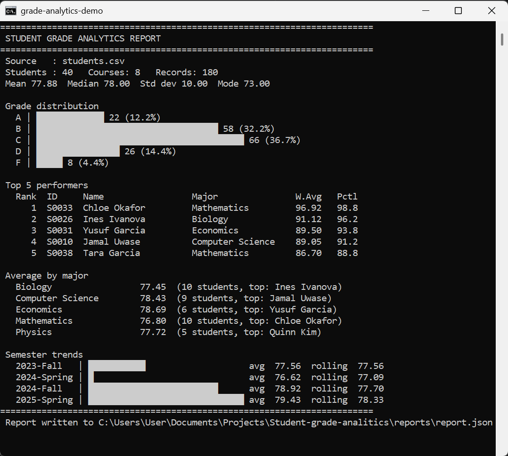

# Student Grade Analytics Tool

A Python 3.11+ command-line tool that reads student grade records from CSV,
computes statistics (averages, distributions, rankings, percentiles, semester
trends) using Python's advanced collections, and writes a structured JSON
report.

It's built around `dataclasses`, `namedtuple`, `Counter`, `defaultdict`,
`OrderedDict`, `deque` and `TypedDict`, with strict type hints throughout
(`mypy --strict` passes), and handles large files with generators.

---

## Contents

- [Features](#features)
- [Project structure](#project-structure)
- [Setup](#setup)
- [Usage](#usage)
- [Input format](#input-format)
- [Sample input / output](#sample-input--output)
- [JSON report reference](#json-report-reference)
- [How the collections are used](#how-the-collections-are-used)
- [Collection performance notes](#collection-performance-notes)
- [Error handling](#error-handling)
- [Testing & type checking](#testing--type-checking)
- [Using it as a library](#using-it-as-a-library)
- [Git workflow](#git-workflow)

---

## Features

- **CSV ingestion** with `pathlib`, `csv.DictReader` and context managers;
  streamed through a generator so memory stays flat on big files.
- **Validation** of every row: missing fields, bad numbers, out-of-range
  scores and malformed semester labels are skipped with a warning
  (or fail fast with `--strict`).
- **Statistics**: mean, median, multimodal mode, standard deviation,
  percentiles and percentile ranks.
- **Grade distribution** (A–F) overall and per course, via `Counter`.
- **Rankings** by credit-weighted average with competition ranking (1, 1, 3)
  and percentile per student.
- **Grouping** by major and by year of study via `defaultdict`.
- **Semester trends** in chronological order with a `deque`-backed rolling
  average.
- **JSON report** whose shape is defined by `TypedDict`s, plus a terminal
  summary with text bar charts.
- **Benchmarks** documenting the memory and speed of each collection choice.

## Project structure

```
.
├── data/
│   ├── students.csv              # 40 students / 180 records (seeded sample)
│   └── messy_students.csv        # deliberately malformed rows
├── docs/
│   ├── PERFORMANCE.md            # benchmark results and design trade-offs
│   ├── sample_output.txt         # terminal output for data/students.csv
│   └── sample_report.json        # full JSON report for data/students.csv
├── scripts/
│   ├── generate_sample_data.py   # reproducible synthetic data generator
│   └── benchmark_memory.py       # collection memory/speed benchmarks
├── src/grade_analytics/
│   ├── models.py                 # Student/Course/Grade dataclasses, GradeRecord namedtuple
│   ├── schemas.py                # TypedDicts describing the JSON report
│   ├── file_io.py                # CSV reader (generator), JSON writer, errors
│   ├── stats.py                  # statistics, Counter distribution, deque RollingAverage
│   ├── aggregators.py            # defaultdict grouping, OrderedDict trends, rankings
│   ├── report.py                 # builds the AnalyticsReport
│   ├── visualization.py          # terminal bar/trend charts
│   └── cli.py                    # command-line interface
├── tests/                        # pytest suite (130 tests + doctests)
├── pyproject.toml
└── requirements.txt
```

## Setup

Requires **Python 3.11 or newer**.

```bash
git clone https://github.com/Victoire67/Student-grade-analitics.git
cd Student-grade-analitics

python -m venv .venv
# Windows (PowerShell)
.venv\Scripts\Activate.ps1
# macOS / Linux
source .venv/bin/activate

pip install -r requirements.txt   # pytest, mypy
pip install -e .                  # installs the `grade-analytics` command
```

The tool itself has **no runtime dependencies** beyond the standard library.

## Usage

```bash
grade-analytics data/students.csv -o reports/report.json
# or, without installing:
python -m grade_analytics data/students.csv        # with src/ on PYTHONPATH
```

| Option | Default | Description |
|---|---|---|
| `input` | — | CSV file to analyse |
| `-o`, `--output` | `reports/report.json` | Where to write the JSON report (parent folders are created) |
| `--top N` | `5` | Number of entries in `top_performers` |
| `--window W` | `3` | Rolling-average window, in semesters |
| `--strict` | off | Stop at the first invalid row instead of skipping it |
| `-q`, `--quiet` | off | Don't print the terminal summary |
| `--version` | | Print the version |

Exit code is `0` on success and `1` on any data or file error.

Generate a bigger dataset to try it at scale:

```bash
python scripts/generate_sample_data.py -n 50000 -o data/large_students.csv
grade-analytics data/large_students.csv -o reports/large.json -q   # ~5 s
```

## Input format

A UTF-8 CSV (a BOM is fine) with one row per student per course per semester:

| Column | Type | Example | Rules |
|---|---|---|---|
| `student_id` | str | `S0001` | required |
| `name` | str | `Umar Garcia` | required |
| `major` | str | `Computer Science` | required |
| `year` | int | `3` | ≥ 1 |
| `course_code` | str | `CS101` | required |
| `course_name` | str | `Intro to Programming` | required |
| `credits` | int | `4` | > 0, used for weighted averages |
| `semester` | str | `2024-Fall` | `YYYY-Season` (Spring, Summer, Fall) |
| `score` | float | `87.5` | 0–100 |

Letter grades use the 10-point scale: A ≥ 90, B ≥ 80, C ≥ 70, D ≥ 60, F < 60.

## Sample input / output

**Input** (`data/students.csv`, first rows):

```csv
student_id,name,major,year,course_code,course_name,credits,semester,score
S0001,Umar Garcia,Computer Science,3,BIO101,Cell Biology,3,2023-Fall,79
S0001,Umar Garcia,Computer Science,3,CS101,Intro to Programming,4,2024-Spring,80
S0001,Umar Garcia,Computer Science,3,STAT201,Probability & Statistics,3,2024-Fall,78
S0002,Tara Mugisha,Biology,2,PHYS101,Mechanics,4,2023-Fall,64
```

**Command**

```bash
grade-analytics data/students.csv -o reports/report.json
```

**Terminal output** (also in [docs/sample_output.txt](docs/sample_output.txt)):

```
========================================================================
 STUDENT GRADE ANALYTICS REPORT
========================================================================
 Source   : students.csv
 Students : 40   Courses: 8   Records: 180
 Mean 77.88  Median 78.00  Std dev 10.00  Mode 73.00

 Grade distribution
   A | █████████████ 22 (12.2%)
   B | ███████████████████████████████████ 58 (32.2%)
   C | ████████████████████████████████████████ 66 (36.7%)
   D | ████████████████ 26 (14.4%)
   F | █████ 8 (4.4%)

 Top 5 performers
   Rank  ID     Name                 Major               W.Avg   Pctl
      1  S0033  Chloe Okafor         Mathematics         96.92   98.8
      2  S0026  Ines Ivanova         Biology             91.12   96.2
      3  S0031  Yusuf Garcia         Economics           89.50   93.8
      4  S0010  Jamal Uwase          Computer Science    89.05   91.2
      5  S0038  Tara Garcia          Mathematics         86.70   88.8

 Average by major
   Biology                 77.45  (10 students, top: Ines Ivanova)
   Computer Science        78.43  (9 students, top: Jamal Uwase)
   Economics               78.69  (6 students, top: Yusuf Garcia)
   Mathematics             76.80  (10 students, top: Chloe Okafor)
   Physics                 77.72  (5 students, top: Quinn Kim)

 Semester trends
   2023-Fall   | ███████████                    avg  77.56  rolling  77.56
   2024-Spring | █                              avg  76.62  rolling  77.09
   2024-Fall   | █████████████████████████      avg  78.92  rolling  77.70
   2025-Spring | ██████████████████████████████ avg  79.43  rolling  78.33
========================================================================
 Report written to reports/report.json
```

**Malformed input** (`data/messy_students.csv`) — bad rows are reported and skipped:

```
WARNING: messy_students.csv: skipped line 4: could not convert string to float: 'not_a_number'
WARNING: messy_students.csv: skipped line 6: missing value for 'name'
WARNING: skipped grade for S9004/ECON101: Score must be between 0.0 and 100.0, got 105.0
WARNING: skipped grade for S9004/STAT201: Invalid semester 'Fall-2024'; expected 'YYYY-Season'
...
 Skipped 4 invalid row(s); see warnings above.
```

## JSON report reference

The full example is [docs/sample_report.json](docs/sample_report.json). Every
section's shape is declared as a `TypedDict` in
[schemas.py](src/grade_analytics/schemas.py), so mypy checks the report builder.

```jsonc
{
  "metadata": {
    "generated_at": "2026-10-26T20:36:25+00:00",
    "source_file": "students.csv",
    "tool_version": "1.0.0",
    "student_count": 40,
    "course_count": 8,
    "record_count": 180
  },
  "overall_statistics": {
    "count": 180, "mean": 77.88, "median": 78.0, "mode": [73.0],
    "std_dev": 10.0, "minimum": 49.0, "maximum": 100.0
  },
  "grade_distribution": { "A": 22, "B": 58, "C": 66, "D": 26, "F": 8 },
  "top_performers": [
    {
      "rank": 1, "student_id": "S0033", "name": "Chloe Okafor",
      "major": "Mathematics", "year": 2, "average": 96.75,
      "weighted_average": 96.92, "percentile": 98.75, "letter": "A"
    }
    // ... up to --top entries
  ],
  "rankings": [ /* every graded student, same shape as top_performers */ ],
  "by_major": {
    "Biology": { "student_count": 10, "average": 77.45, "top_student": "Ines Ivanova" }
    // ... one entry per major, sorted
  },
  "by_year": { "Year 1": { /* GroupSummary */ }, "Year 2": { /* ... */ } },
  "courses": {
    "CS101": {
      "course_name": "Intro to Programming", "credits": 4, "enrollment": 21,
      "statistics": {
        "count": 21, "mean": 81.0, "median": 80.0, "mode": [80.0],
        "std_dev": 8.31, "minimum": 68.0, "maximum": 99.0
      },
      "grade_distribution": { "A": 3, "B": 9, "C": 7, "D": 2, "F": 0 }
    }
    // ... one entry per course, sorted by code
  },
  "semester_trends": [
    { "semester": "2023-Fall",   "average": 77.56, "rolling_average": 77.56 },
    { "semester": "2024-Spring", "average": 76.62, "rolling_average": 77.09 },
    { "semester": "2024-Fall",   "average": 78.92, "rolling_average": 77.7 },
    { "semester": "2025-Spring", "average": 79.43, "rolling_average": 78.33 }
  ]
}
```

Notes:

- `weighted_average` weights each score by course credits; rankings sort on it.
- `percentile` is the share of students scoring below, with ties counted half.
- `mode` is a list because data can be multimodal.
- Statistics are `null` when a group has no scores.
- All floats are rounded to 2 decimals; section keys are sorted so reports diff cleanly.

## How the collections are used

| Collection | Where | Purpose |
|---|---|---|
| `dataclass(slots=True)` | `Student`, `Grade`, `Course` (`models.py`) | Validated models with methods; slots cut memory ~30% |
| `dataclass(frozen=True)` | `Course`, `Grade` | Immutable and hashable |
| `namedtuple` | `GradeRecord` (`models.py`) | Lightweight immutable CSV row yielded by the reader |
| `Counter` | `mode`, `grade_distribution` (`stats.py`) | Frequency counting, `most_common()` |
| `defaultdict(list)` | `group_by`, `scores_by_course` (`aggregators.py`) | One-pass grouping without key checks |
| `OrderedDict` | `semester_averages`, report sections (`report.py`) | Chronological trends and deterministic section order |
| `deque(maxlen=w)` | `RollingAverage` (`stats.py`) | O(1) rolling-window average over semesters |
| `TypedDict` | `schemas.py` | Type-checked JSON report structure |
| `Union` / `Optional` | `load_students(source: Union[PathLike, Iterable[GradeRecord]])`, `Student.average -> Optional[float]` | Flexible inputs, explicit missing values |

## Collection performance notes

Full results and methodology are in [docs/PERFORMANCE.md](docs/PERFORMANCE.md).
Highlights from 100,000 records (`python scripts/benchmark_memory.py`):

| Comparison | Result |
|---|---|
| Record storage: `dict` → slotted `dataclass` | 26.7 MiB → 10.7 MiB (**−60%**) |
| `namedtuple` vs plain `dataclass` | 13.0 MiB vs 15.3 MiB |
| Peak memory: `list(...)` vs generator | 44.5 MiB → 0.17 MiB |
| Rolling average: `list.pop(0)` vs `deque(maxlen)` | 25.1 ms → 14.8 ms |
| Prepend 50k items: `list.insert(0)` vs `deque.appendleft` | 397 ms → 2.1 ms |
| Counting: manual `dict` vs `Counter` | 7.8 ms → 4.2 ms |
| Percentile ranks: per-student scan vs sort + `bisect` | 6 min 44 s → 5 s on 225k records |

## Error handling

| Situation | Behaviour |
|---|---|
| File not found / is a directory / permission denied | `DataLoadError`, CLI prints `error: ...` and exits 1 |
| Not valid UTF-8 | `DataLoadError` |
| Missing required columns | `DataLoadError` naming the missing columns |
| Bad row (missing field, non-numeric, score out of range, bad semester) | Logged and skipped; `--strict` raises `InvalidRecordError` |
| CSV with no valid rows | CLI exits 1 with `no valid records` |
| Report can't be written | `ReportWriteError`, exit 1 |

## Testing & type checking

```bash
pytest            # 130 tests + doctests
mypy              # strict mode over src/ and tests/
```

The suite covers each collection type (`Counter`, `defaultdict`,
`OrderedDict`, `deque`, `namedtuple`, dataclasses), every statistic (checked
against the `statistics` module), all file error paths, the report schema
against its `TypedDict`s, the sample datasets, and the CLI end to end.

## Using it as a library

```python
from grade_analytics.file_io import load_students, write_json_report
from grade_analytics.report import build_report
from grade_analytics.aggregators import group_by_major, top_performers
from grade_analytics.stats import RollingAverage

students = load_students("data/students.csv")

for row in top_performers(students, n=3):
    print(row["rank"], row["name"], round(row["weighted_average"], 2))

cs_students = group_by_major(students)["Computer Science"]

ra = RollingAverage(window=3)
print([ra.add(x) for x in (70, 80, 90, 100)])   # [70.0, 75.0, 80.0, 90.0]

write_json_report(build_report(students, source_file="students.csv"), "reports/report.json")
```

## Git workflow

- `main` — released code only.
- `dev` — integration branch; all work merges here first.
- Short-lived branches off `dev`, merged with `--no-ff`:
  `feature/*`, `fix/*`, `test/*`, `perf/*`, `docs/*`, `chore/*`, `ci/*`.
- Commits follow [Conventional Commits](https://www.conventionalcommits.org/)
  (`feat(stats): ...`, `fix(cli): ...`, `perf(aggregation): ...`).

## Screenshot


